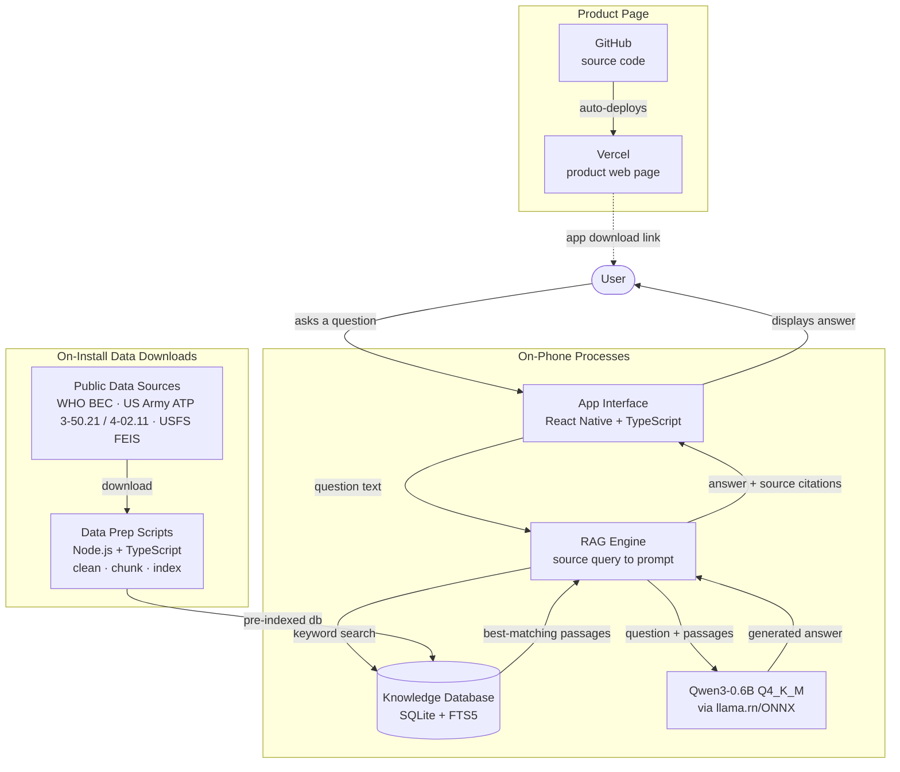
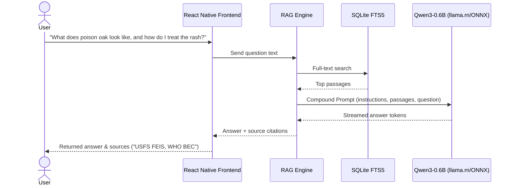

<p align="center">
  
</p>

<h3 align="center">An AI Wilderness App — bringing the power of LLMs outdoors</h3>

<p align="center">
  CS-195 Senior Seminar · Fall 2026 · Ryan Magnuson<br>
  <sub>Project proposal v0.5 (rolling draft), submitted 9/12/2026</sub>
</p>

---

## Contents

1. [Project & Course Information](#01--project--course-information)
2. [Overview & Problem](#02--overview--problem)
3. [Functional Requirements](#03--functional-requirements)
4. [Technical Design & Quality](#04--technical-design--quality)
5. [Evidence & Justification](#05--evidence--justification)
6. [Mission & Milestone OKRs](#06--mission--milestone-okrs)
7. [Milestone Grading Criteria](#07--milestone-grading-criteria)
8. [References & Acknowledgments](#08--references--acknowledgments)
9. [Development](#development)

---

## 01 · Project & Course Information

| | |
|---|---|
| **Project title** | Fred |
| **Author** | Ryan Magnuson |
| **Course** | CS-195 Senior Seminar |
| **Term** | Fall 2026 |
| **Instructor** | Mike Ryu |
| **Submitted** | 9/12/2026 |
| **Version** | v0.5 — Rolling First Draft |

---

## 02 · Overview & Problem

### Overview

When out in the wilderness, questions can arise. Oftentimes, the wilderness supplies
few answers to these questions; "Where am I?" "How do I start a fire?" "I cut myself,
what do I do?" are met with deaf ears, like a tree falling in a forest. Fred is for
people with questions with no other way to ask them. The great outdoors frequently has
spotty-at-best connection to WiFi, data, and the rest of the modern world, so Fred
lives on-device as a stand-in AI guru, assisting in survival know-how and identifying a
user's last known whereabouts. In other words, Fred is a security anchor for the
less-travelled adventurer, for the explorer who accidentally wandered off the trail,
for the thrill-seeker hiker who just twisted an ankle. Fred doesn't replace human best
judgement and reasoning, but instead provides additional counsel when a question arises
that fails otherwise be answered.

Fred will have access to wildlife, plantlife, and first aid knowledge corpora, track
your location until connection is lost, show a local map of the surrounding area of a
user's last known location, and even point out possible locations to visit to regain
connection — all offline.

### Motivation

**Personal interest.** Starting out on the project brainstorming process, I decided to
make sure whatever project I ended up choosing should be one that leverages local LLMs,
because of how written-off a technology it is. Of course, local LLMs aren't dismissed
for no good reason: relative to an enterprise model, they perform as a child would. To
me, that meant I had to find a vertical where using an enterprise model wasn't an
option. Where are you most cut off from the Internet of Things? The great outdoors.
Things began clicking: running a model on my phone.

The true personal investment clicked soon after for me. My grandfather, Fred, passed
away a few years ago. He served 45 years as part of the USDA Forest Service — I still
remember visiting his home in Wisconsin, seeing the maps he made on the walls and the
topographical software running on his ancient computer. I called his daughter, my
mother, about this idea — she really liked it.

**Evidence others care.** To prove I wasn't blind firing into the sky with this idea, I
looked in two places: my immediate social circles, and the Internet. Online, I looked
at similar projects, of which there were a handful: Survia, NOMAD, SurvivorAI, to name a
few. This means people are thinking about this pain point, and I think I can do a
better job at addressing it. Furthermore, I talked to the people around me: outdoorsy
types, shut-ins, even EMTs. Even after a three to four minute rundown, they saw the
value. The EMT thought even further, realizing he could use it during rescues without
signal, to help find a nearby location to regain connection and make a call.

### Problem Statement

| | |
|---|---|
| **Who** | Rowdy College Student Hiking Group |
| **Context** | On a hiking trail with no signal, where one particularly excited student ends up badly twisting an ankle. |
| **How it's handled today** | The students rally, put their heads together, and try to help out their fallen comrade by hefting them up and carrying them. One student runs around wildly to try to get service on their phone, to call for help. They slowly make their way back out of the trail. |
| **What's still hard** | • The students did not consider what the best immediate form of treatment should be.<br>• The students had no way to make a call besides hoping to get lucky.<br>• The students only had each other as resources to rely on — if the group doesn't know something, they can't answer what they don't know. |
| **Evidence** | Westmont College is a small Christian liberal arts school in Santa Barbara, CA, with many surrounding hiking trails. In 2024, a nameless student attending Westmont broke his ankle near the top of the trail and was escorted back down the trail by two other students, until they luckily found signal and were able to call for assistance. If they had not found signal, they would have had to escort the injured peer down a rock wall, adjacent to a waterfall, via a single knotted rope. The above fictional example mirrors real things that have happened in the real world. |

### Proposed Solution

Fred effectively serves as a means to provide information to the uncertain user. In an
emergency situation, instead of having absolutely nothing, the user has the ability to
glean relevant information on their situation from Fred. To boil it down, Fred is a
"Survival Info FAQ" book that users talk to regarding their exact situation.

| Problem | Solution |
|---|---|
| User has a first-aid level injury | The user is empowered by a RAG-fueled LLM with a USA military first aid knowledge corpus that can answer their questions. |
| User doesn't know what wildlife they might find in their surrounding area | Based on the user's last known location, the LLM can supply known regional wild and plant life to the user. |
| User is lost, without signal | The app provides a map of the local area, and suggests a landmark that might allow the user to regain signal. |

### Scope

| Core — committed by RC | Stretch — after core | Out of scope |
|---|---|---|
| RAG-empowered local LLM that accurately and coherently answers relevant questions. | The product website is up-and-running. | Voice & photo input functionality. |
| Last-known location tracking, pairing with local map functionality. | Based on last known location, predict where signal might be regained nearby. | General purpose LLM capabilities (i.e. an "all rounder" model). |
| Simple & polished app experience, available on GitHub. | The app is published to Google Play and Apple App Stores. | Folding a user's laundry while pouring a cup of coffee. |
| | LLM confidence layer that rejects responses that the LLM lacks information on. | |

---

## 03 · Functional Requirements

### Core Stories

| ID | Story | Priority | Milestone |
|---|---|---|---|
| [US-01](#us-01--ask-about-surrounding-fauna-and-flora) | Ask about surrounding fauna and flora | Core | Alpha |
| [US-02](#us-02--ask-first-aid-questions-when-hurt) | Ask first-aid questions when hurt | Core | Alpha |
| [US-03](#us-03--see-cited-sources-on-llm-responses) | See cited sources on LLM responses | Core | Alpha |
| [US-04](#us-04--be-told-when-the-llm-does-not-know) | Be told when the LLM does not know | Stretch | RC |
| [US-05](#us-05--learn-rough-estimate-location-when-out-of-service-range) | Learn rough-estimate location when out of service range | Core | Beta |
| [US-06](#us-06--get-directions-on-how-to-regain-signal) | Get directions on how to regain signal | Stretch | RC |
| [US-07](#us-07--stop-an-in-progress-response) | Stop an in-progress response | Core | Beta |
| [US-08](#us-08--ask-about-camping-essentials) | Ask about camping essentials | Core | Alpha |
| [US-09](#us-09--learn-about-fred-and-his-existence) | Learn about Fred and his existence | Stretch | RC |
| [US-10](#us-10--re-read-previous-conversations) | Re-read previous conversations | Core | RC |
| [US-11](#us-11--respond-under-poor-hardware-conditions) | Respond under poor hardware conditions | Core | Beta |
| [US-12](#us-12--learn-how-to-build-a-shelter) | Learn how to build a shelter | Core | Beta |

#### US-01 · Ask about surrounding fauna and flora

> As a hiker unfamiliar with local fauna and flora, I want to ask about species in the
> state I'm currently in, so that I can determine my level of general safety.

**Priority** Core · **Milestone** Alpha · **Depends on** LLM RAG Corpora Functionality

**US-01-AC1 — Fauna and flora inquiry**
- **Given** the user is in Oregon
- **When** the user makes a query along the lines of: "What plants and animals are near me?"
- **Then** the LLM cites the Oregon knowledge corpus in its response, detailing Oregon's flora and fauna.

#### US-02 · Ask first-aid questions when hurt

> As an outdoorsman or outdoorswoman, I want to ask about how best to treat a cut in the
> wild, so that I can help myself stay protected against the elements if/when I get hurt.

**Priority** Core · **Milestone** Alpha · **Depends on** LLM RAG Corpora Functionality

**US-02-AC1 — Live first aid question**
- **Given** the user has suffered a minor injury
- **When** the user makes a query along the lines of: "I cut myself on a branch, what should I do?"
- **Then** the LLM responds by citing the downloaded first aid knowledge corpus and supplying an accurate response/process to address the wound per the user's situation.

#### US-03 · See cited sources on LLM responses

> As an outdoorsman or outdoorswoman, I want to see where the information Fred gives me
> is coming from, so that I can make my own judgement call on whether or not to trust
> the LLM, or even read the material myself.

**Priority** Core · **Milestone** Alpha · **Depends on** LLM RAG Corpora Functionality

**US-03-AC1 — View a source**
- **Given** the user has asked a corpora-based question and has received an answer
- **When** the user is wondering whether or not to trust the LLM's response
- **Then** the user can see the LLM's source text and passage referenced for the response.

#### US-04 · Be told when the LLM does not know

> As an impressionable and unknowledgeable individual, I want to be told that Fred is
> unsure of something or simply doesn't know an answer, so that I don't make decisions
> based on LLM hallucinations.

**Priority** Stretch · **Milestone** RC · **Depends on** LLM RAG Corpora Functionality Baseline & Response confidence ratings

**US-04-AC1 — Receive a negative response**
- **Given** a user has little experience in the outdoors
- **When** this user asks a question that Fred does not know the answer to
- **Then** Fred tells the user that he does not know the answer, instead of making an answer up.

#### US-05 · Learn rough-estimate location when out of service range

> As a wanderer or lost hiker, I want to ask Fred where I am, so that I can get my
> bearings, and figure out where I need to go.

**Priority** Core · **Milestone** Beta · **Depends on** Last Known Location Tracking & Local Map System

**US-05-AC1 — Lost, and request to be found**
- **Given** the user is lost, and has no signal or service
- **When** the user asks Fred "where am I?"
- **Then** Fred responds with a brief text summary and map of the surrounding area, with a circle range estimate of the user's location.

#### US-06 · Get directions on how to regain signal

> As a wanderer or lost hiker, I want to ask Fred where I can get signal, so that I can
> search something up or make a call.

**Priority** Stretch · **Milestone** RC · **Depends on** US-05-AC1 Core

**US-06-AC1 — Lost, and request to find service**
- **Given** the user is lost, and has no signal or service
- **When** the user asks Fred "I don't have any service, what should I do?"
- **Then** Fred responds with a map akin to US-05-AC1, with an additional highlighted area for possible service coverage areas.

#### US-07 · Stop an in-progress response

> As a hiker with little remaining battery, I want to stop Fred's responses, so that I
> can save my battery if need be, or ask a more pressing question.

**Priority** Core · **Milestone** Beta · **Depends on** Frontend App Shell Development

**US-07-AC1 — Stop an active request**
- **Given** a user is running low on battery
- **When** the user wants to stop a question Fred is already responding to, to save on battery, so they press the "stop" button in the app
- **Then** Fred halts his active response processes.

#### US-08 · Ask about camping essentials

> As a new camper, I want to ask Fred my camping questions, so that I can supplement my
> lack of experience while camping.

**Priority** Core · **Milestone** Alpha · **Depends on** LLM RAG Corpora Functionality & Per-State Wildlife Knowledge Corpus

**US-08-AC1 — How to start a fire**
- **Given** a user does not know how to start a fire
- **When** the user asks Fred "I have no idea how to start a fire! I have XYZ materials/tools…"
- **Then** Fred gives a step-by-step rundown on how to start a fire.

**US-08-AC2 — How to deal with camp food**
- **Given** a user does not know what to do with their food
- **When** the user asks "I have a cooler with some sandwiches and breakfast sausages in it, can animals get in?"
- **Then** Fred responds in the affirmative, and gives advice on how best to protect the food in the campsite, based on local wildlife.

#### US-09 · Learn about Fred and his existence

> As a curious soul on the Internet, I want to find a wilderness product that answers my
> questions, so that I can be better prepared.

**Priority** Stretch · **Milestone** RC · **Depends on** Product Website Development

**US-09-AC1 — Stumble across Fred**
- **Given** a user-to-be is interested in a wilderness app like Fred
- **When** the user-to-be searches up wilderness apps that might suit their needs
- **Then** the user-to-be finds a Fred product landing page/website that has information about the app available, alongside download information.

#### US-10 · Re-read previous conversations

> As a Fred user, I want to read my old conversations, so that I can remind myself of
> something else I talked about with Fred.

**Priority** Core · **Milestone** RC · **Depends on** Frontend App Development

**US-10-AC1 — Visit a previous conversation**
- **Given** a user forgot something that Fred told them
- **When** they open the Fred app to figure out what the lost information was
- **Then** they can look back on previous conversations to remind themselves about what they forgot.

#### US-11 · Respond under poor hardware conditions

> As a user with a weaker mobile device, I want to still be able to use Fred, so that I
> still have a way to get my questions answered to some degree, if I really need it.

**Priority** Core · **Milestone** Beta · **Depends on** LLM RAG Corpora Functionality & Hardware Optimization

**US-11-AC1 — Using new tech with an old phone**
- **Given** a user has an older generation of mobile device, with weaker hardware
- **When** the user asks any question to Fred
- **Then** Fred's response is shorter, and still within a reasonable amount of time.

#### US-12 · Learn how to build a shelter

> As a lost hiker, I want to figure out how to build a rudimentary shelter, so that I
> have some cover from the elements, if I need to spend the night outdoors.

**Priority** Core · **Milestone** Beta · **Depends on** LLM RAG Corpora Functionality

**US-12-AC1 — How to build shelter**
- **Given** it's getting late, and a user has decided to set up to spend the night outside
- **When** the user asks "How do I build a shelter?"
- **Then** Fred gives a step-by-step walkthrough on how best to build a simple shelter.

---

## 04 · Technical Design & Quality

### System Diagram

The core behind Fred is a straightforward and lightweight RAG system, arming an
otherwise simpleminded local LLM with reliable information to reference when
responding to the user. Detailed below is the visual summary of this operation,
alongside represented data sources, and how a user might come across this application
in the first place.

**Figure 1 — Full System Diagram**



### Walkthrough

For example, a user asks a flora corpus-relevant question:

1. Query: "What does poison oak look like, and how do I treat the rash?"
2. Question text is sent to RAG core
3. SQLite full text search finds top relevant passages & sources
4. A compound prompt (RAG output and user query) is sent to the local LLM
5. User receives an informed response, with sources (i.e. "I referenced USFS FEIS…")

**Figure 2 — User Walkthrough**



### Components & Choices

| Component | Choice | Why it fits | Alternatives · tradeoffs |
|---|---|---|---|
| Frontend / UI | React Native | Android & iOS compatibility, plus sleek component-based design system. | Flutter/Dart; I have no experience with this technology. |
| Backend & processing | Serverless LLM RAG core | This is the point of the project. | Pursue a different project. |
| Data · model · DBMS | SQLite + FTS5 · Qwen3-0.6B Q4_K_M · WHO BEC · US Army ATP 3-50.21 & 4-02.11 · USFS FEIS | Classic SQL DBMS with full text search referencing compatibility, given to a lightweight and capable model, storing quality data. | GraphQL + knowledge graph; further research required. |
| Languages · frameworks · APIs · hardware | TypeScript · Node.js · llama.rn (generation) · ONNX Runtime (embedding) | Generation runs through llama.rn; embedding moved to ONNX Runtime so ingest and device produce identical vectors. | Keep llama.rn for both; rejected — the two runtimes did not embed alike (`docs/results-m3.md`). |
| Hosting & deployment | Vercel for product page | Vercel links directly into GitHub, making development easy. | ngrok hosting. |
| Auth · permissions · sensitive data | Authless experience, all data stays on-device. | Login processes add unneeded friction when all app information is stored locally, and meant to be used offline. | If needed, set up a simple server machine for auth purposes. Greater friction and overhead. |
| User feedback | Run trial and focus groups with Fred. | This permits receiving real world user feedback while a proper feedback system on-app is pending. | On-app review system while online. |
| Testing & evaluation | Claude Opus 5 & local LLM accuracy evaluation | This allows a smarter enterprise model to evaluate the performance of Fred, armed with a Q&A test with marked correct answers. | Online model performance benchmarking websites. |

### Quality Requirements

| ID | Attribute | Target | Verification |
|---|---|---|---|
| QR-01 | Response Time | < 10 s | Over a series of RAG-empowered queries, time each response and measure the average. |
| QR-02 | Response Accuracy | > 90% | Give an enterprise model a test to administer to Fred, alongside an answer sheet. Compare Fred's outputs to the expected answers, determine if an answer is acceptable or not, and compare correct to incorrect responses. |

---

## 05 · Evidence & Justification

### Alternatives

| Alternative | How it runs | Response confidence | Location tracking | Data sources |
|---|---|---|---|---|
| Manual Workflow | Slow and heavy paper pamphlets and books | Up to the reader's interpretation of the text; no clarifying questions | Good luck with your paper map from several years ago. | Whatever gift shop you wandered into. |
| Prepper AI | On-Device | Not stated. | Rudimentary offline maps | Reputable books (TCCC, FEMA); no citations. |
| SurvivorAI | Unreleased app | Colored answer confidence label | Rudimentary offline maps | 228 named sources and citations. |
| SURVIA | 6GB+ RAM iPhone Beta | Cautious about plant consumption | Maps and GPS | 6.34GB local library; no named sources or citations. |
| Project NOMAD | Self-hosted server, non-portable | Not stated. | Rudimentary offline maps | Wikipedia and self-uploaded content. |
| **Fred** | **On-Device, low memory consumption** | **Halts when providing an unsupported answer.** | **Offline maps with location and service prediction** | **Lightweight and curated set of corpora, with citations.** |

### Market Overview

| | |
|---|---|
| **Done well** | Bare-bones LLMs, with simple offline maps. |
| **Unmet need** | A complete package experience of a fast local LLM paired with location tracking, all offline. |
| **Why it's substantial** | The difference is in user experience, and in practicality. Fred will be able to serve quickly-digestible answers alongside the original source to better answer user queries, as well as track user location to the best of his ability, making Fred a wilderness no-brainer draft pick. |

### Feasibility

**Available time:** ~15 hrs/week × 4 × 4 months to RC → ~240 hrs

| Milestone | Date | Stories | Deliverables | Test · revision |
|---|---|---|---|---|
| Alpha | 10/19/2026 | US-01→04, US-08, US-11→12 | LLM RAG system is functional and accurate, with corpora. | Compare Fred's outputs with an enterprise model to grade and score accuracy. |
| Beta | 11/16/2026 | US-05 | Local map systems are functional; service assistance is available. | Physically relocate to different locations to determine accuracy & usefulness. |
| RC | 12/9/2026 | US-07, US-10 | The frontend is finalized, and users can download the app. | Open website on both iOS and Android and attempt to download. |

### Risks

| ID | Assumption at risk | Likely effect | Investigate · when | Fallback |
|---|---|---|---|---|
| R-01 | The LLM RAG system does not produce accurate responses. | The project's scope becomes dramatically reduced. | ASAP, Sprint 0. | Proceed to conversations with instructor Mike Ryu on how to pivot. |
| R-02 | The multitude of knowledge corpora make the app obscenely large. | Users are disinterested in the product due to its storage greediness. | Beta Release | Consider alternative strategies, such as having the user pick and choose what to download. |
| R-03 | The local map + service assistance systems are non-functional. | The app's practicality and use takes a hit. | Beta Release | Consider alternative solutions, such as GPS or radio. |

### Cost

| Item | Price | Usage assumption | Free-tier limit | Estimate | Fallback |
|---|---|---|---|---|---|
| Claude Code | $20/Month | Maximal Session Usage | Unhelpful, non-option. | $60 | Gemini Pro Student Subscription |
| iOS App Store Publication | $100, One-Time | Provide an official download | Nonexistent. | $100 | Provide download via product website + GitHub |
| Domain Name | ~$12/Year | A couple years | Unhelpful, non-option. | ~$25 | Simply use GitHub as a rudimentary landing page. |
| Vercel | Free Tier | Light activity & web traffic | 100GB data, 1M user requests | $0 | ngrok hosting |

### Broader Constraints

| Constraint | Consideration | Effect on scope · design |
|---|---|---|
| Licensing & Data permissions | Knowledge Corpora | Be conscious of what data sources used for RAG corpora. See [`docs/licensing.md`](docs/licensing.md). |
| Privacy | Personal User Input & Info | Fred won't track any personal data — we're not Meta. |
| Accessibility | Price & Platform | Fred will be free-to-use, on a donation income model. Available on iOS & Android. |
| Social Impact | How people would otherwise handle a problem together in the wilderness | Fred isn't here to redefine how people work together in the wild, but instead help them make informed decisions, together. |

---

## 06 · Mission & Milestone OKRs

> **Mission:** Fred provides a means for anyone to confidently wander throughout the
> natural world.

### Alpha — 10/19/2026

**Objective:** Local LLM RAG system is functional and accurate, with necessary corpora.

| ID | Result | Measurement | Target · deadline | Verification | Connects to |
|---|---|---|---|---|---|
| A-KR1 | Fred can make informed responses based off his knowledge corpora | The following corpora are all accounted for: First Aid · Per-state flora & fauna · Survival skills | 9/18/2026 | When asked a corpora-relevant question, Fred uses RAG on the proper material. | US-01→04, US-08, US-11→12 |
| A-KR2 | Fred's responses are useful and accurate | > 90% LLM accuracy in all corpora-related questions | 10/12/2026 | Test Fred's inputs/outputs against an enterprise model armed with an answer sheet | US-01→04, US-08, US-11→12 |
| A-KR3 | Fred's responses are quick and timely | < 10 s LLM response time, per query | 10/19/2026 | Run a series of queries, timing each response. | US-01→04, US-08, US-11→12 |

### Beta — 11/16/2026

**Objective:** The application tracks the user's last known location, for the purposes
of serving maps of the surrounding location, and providing suggestions on how to find
service.

| ID | Result | Measurement | Target · deadline | Verification | Connects to |
|---|---|---|---|---|---|
| B-KR1 | While in service, Fred is aware of a user's location. | When running, the app can retrieve a user's location within a few meters of accuracy. | 10/26/2026 | Drive to different physical locations and run the estimation program, WiFi on. | US-05 |
| B-KR2 | Fred can provide a user's estimated location. | The user can access a map with an estimated location zone, within ~1 km of accuracy. | 11/10/2026 | Drive to different physical locations and run the estimation program, WiFi off. | US-05 |
| B-KR3 | Fred can provide suggestions on where to go to find service. | The user can access a map with the estimated location zone alongside a shaded "possible service" region, within ~1 km of accuracy. | 11/16/2026 | Drive to different physical locations and run the estimation program, WiFi off. | US-05 |

### Release Candidate — 12/9/2026

**Objective:** Fred has a public product page & website, with downloads available for an
iOS & Android frontend application.

| ID | Result | Measurement | Target · deadline | Verification | Connects to |
|---|---|---|---|---|---|
| RC-KR1 | Fred is available as an app, compatible with both iOS and Android. | Both Android and iOS users can download and properly use Fred. | 11/25/2026 | Test on both Android and iOS, from discovery to download to use. | US-07, US-10 |
| RC-KR2 | Fred has a public product page & website. | The site is publicly accessible, with a means to download Fred from GitHub. Site contains: Home page · Donation button · About Page | 12/2/2026 | Navigate through site on a different computer; test donation system on a different computer. | US-07, US-10 |
| RC-KR3 | Fred's product page has promotional material. | Displayed on-page are at least 3 videos and 8 images of Fred use and content. | 12/9/2026 | See that the promotional material exists. | US-07, US-10 |

---

## 07 · Milestone Grading Criteria

↑ higher is better · ↓ lower is better

| KR | Metric & evidence | A | B | C | D | F |
|---|---|---|---|---|---|---|
| A-KR1 | Necessary Knowledge Corpora | All needed corpora are functional. | Most required corpora are functional. | Bare minimum corpora are functional. | Corpora is missing or non-functional. | The entire RAG-corpora system is non-functional. |
| A-KR2 | Accuracy ↑ | > 90% | 90–80% | 79–70% | 69–60% | < 60% |
| A-KR3 | Response Time ↓ | < 10 s | 10–20 s | 21–40 s | 1–3 m | > 3 m |
| B-KR1 | User Online Location Accuracy ↓ | ±10 m | ±50 m | ±200 m | ±500 m | > ±1 km |
| B-KR2 | User Offline Location Accuracy ↓ | ±1 km | ±2 km | ±3 km | ±4 km | > ±5 km |
| B-KR3 | Predicted Service Zone Accuracy ↓ | ±1 km | ±2.5 km | ±5 km | ±7.5 km | > ±10 km |
| RC-KR1 | App Availability | iOS && Android | iOS \|\| Android | App only works on Expo Go (or equivalent) | App exists, but is barely functional. | App is non-existent. |
| RC-KR2 | Product Page Functionality | 3/3 | 2/3 | 1/3 | 0/3 | Product page does not exist. |
| RC-KR3 | Promotional Material | 3 videos, 8 images | 1 video, 5 images | 1 video, 2 images | 0 videos, 1 image | Zip, nada, nothing. |

**Notes**
- **A-KR1** — Less quantitative, so metrics are described instead of numeric.
- **RC-KR1** — May be up to debate due to unfamiliarity in this arena.

---

## 08 · References & Acknowledgments

### References

1. Vercel Pricing: Hobby, Pro, and Enterprise plans
2. Mermaid | Diagramming and charting tool
3. SURVIA — Offline Survival AI · Bushcraft & Wilderness Help With No Signal
4. Project NOMAD - Offline Knowledge & AI Server
5. Prepper AI - Offline Survival AI
6. SurvivorAI: Offline AI Survival Guide

The retrieval pipeline builds on Kang et al., *PocketRAG: On-Device RAG for First Aid
Guidance in Offline Mobile Environments* — see [`docs/optimizations.md`](docs/optimizations.md).

### Acknowledgments

| Name | Date | Contribution |
|---|---|---|
| Fred James | ~2020 | My inspiration and exigence. |
| Ethan Camp | 9/4/2026 | EMT interview in the overview. |
| Granite\* | ~2024 | Student evidence in the overview. |

\*Last name not provided, for anonymity.

### Templates & AI Use

| | |
|---|---|
| **Template** | Claude: Project Proposal Blank Layout Template · ChatGPT: Cover Page Fred Logo |
| **AI writing assistance** | Claude Opus 5, for grammar, spellcheck, and general legibility. |

---

## Development

### Layout

```
packages/rag-core/     Platform-agnostic retrieval pipeline (TypeScript)
packages/pack-format/  Pack manifest schema + shared types
apps/mobile/           React Native app (Expo dev build)
tools/ingest/          Node: corpus -> chunks -> embeddings -> INT8 -> pack
tools/eval/            Node: ablation harness over MCQ eval sets
docs/                  Design notes, licensing register, results
```

**`rag-core` is deliberately platform-agnostic.** It talks to the world through two
interfaces, `InferenceBackend` and `PackStore` (`packages/rag-core/src/backends.ts`).
The mobile app implements them with `llama.rn` + `op-sqlite`; the eval harness with
`node-llama-cpp` + Node's built-in SQLite. The same pipeline code runs in both, so the
evaluation measures the system that actually ships rather than a reimplementation.

### Develop

Requires Node 22+ (uses native TypeScript execution — no build step for the core).

```bash
npm install
npm test
npm run typecheck
```

### Docs

- [`docs/optimizations.md`](docs/optimizations.md) — PocketRAG technique → implementation,
  and three deliberate deviations
- [`docs/licensing.md`](docs/licensing.md) — source licenses; note the WHO
  NonCommercial constraint
- `docs/results-m0.md` … `docs/results-m3.md` — measured results per milestone
- [`docs/results-alpha.md`](docs/results-alpha.md) — corpora against the proposal's A-KR1

Build packs with `node tools/ingest/src/index.ts <who-bec|atp-3-50-21|atp-4-02-11>`
(source PDFs go under `corpora/`, which is not committed). Per-state plant and wildlife
packs come from USFS FEIS: `node tools/ingest/src/feis-fetch.ts` once, then
`node tools/ingest/src/feis-pack.ts CA OR`. Check corpus coverage with
`node tools/eval/src/coverage.ts`.
